<p align="center"></p>
<h1 align="center">Krypta</h1>
<p align="center">
  Ein kostenloser Open-Source-Passwort-Manager für Windows, bei dem alles auf deinem Computer bleibt.<br>
  Passwörter, Passkeys und Zwei-Faktor-Codes in einem verschlüsselten Tresor. Kein Konto, keine Cloud.
</p>
<p align="center"><a href="README.md">English version</a></p>

<p align="center">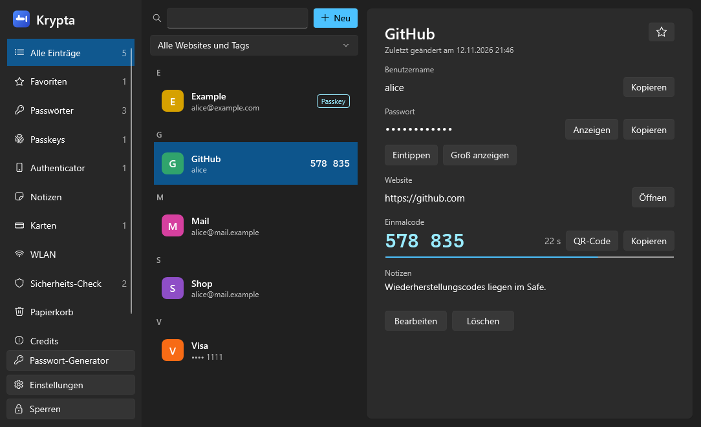</p>

> **Status: frühe Version (0.1).** Krypta wurde bisher nicht von unabhängigen Sicherheitsfachleuten geprüft.
> Bewahre von allem Wichtigen eine Sicherung auf, bis das geschehen ist.

## Inhalt

- [Funktionen](#funktionen)
- [Bildschirmfotos](#bildschirmfotos)
- [So werden deine Daten geschützt](#so-werden-deine-daten-geschützt)
- [Erste Schritte](#erste-schritte)
- [Krypta benutzen](#krypta-benutzen)
- [Browser-Erweiterung](#browser-erweiterung)
- [Fragen und Antworten](#fragen-und-antworten)
- [Für Entwickler](#für-entwickler)
- [Was noch offen ist](#was-noch-offen-ist)
- [Credits und Lizenz](#credits-und-lizenz)

## Funktionen

**Alles in einem Tresor**

- Anmeldungen, sichere Notizen, Zahlungskarten und WLAN-Zugänge.
- Passkeys: auf Websites erstellen und sich damit anmelden.
- Zwei-Faktor-Codes (TOTP), wie bei Microsoft oder Google Authenticator.
- Mehrere Tresore, zum Beispiel einer privat und einer für die Arbeit.

**Schnell finden**

- Eine Liste im Stil von Apples Passwörter-App: farbige Kacheln, alphabetische Abschnitte und Zähler.
- Suche über mehrere Begriffe („git alice“), Filter nach Website und nach Tag, Favoriten.
- Schnellsuche von überall mit `Strg+Alt+K`.

**Sicher bleiben**

- Passwort-Generator mit Entropie-Schätzung.
- Sicherheits-Check für schwache, mehrfach verwendete und geleakte Passwörter.
- Papierkorb, der gelöschte Einträge 30 Tage aufbewahrt, und ein Verlauf der letzten zehn Passwörter je Eintrag.
- Verschlüsselte Backups; Import aus Chrome, Edge, Firefox, Bitwarden, KeePass und KeePassXC.

**Komfort**

- Deutsch und Englisch, jederzeit umschaltbar.
- Helle oder dunkle Darstellung und sechs Akzentfarben.
- Anmeldungen im Browser ausfüllen oder ein Passwort von Krypta in ein beliebiges Fenster tippen lassen.

## Bildschirmfotos

| | |
|---|---|
| 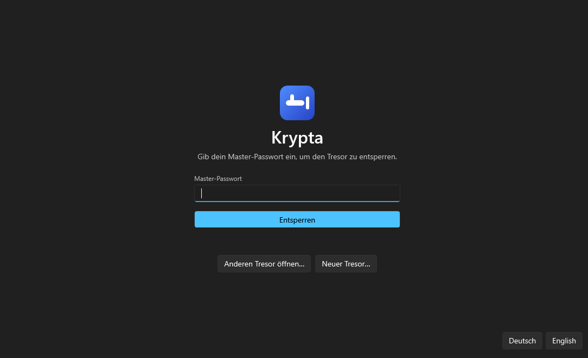 | 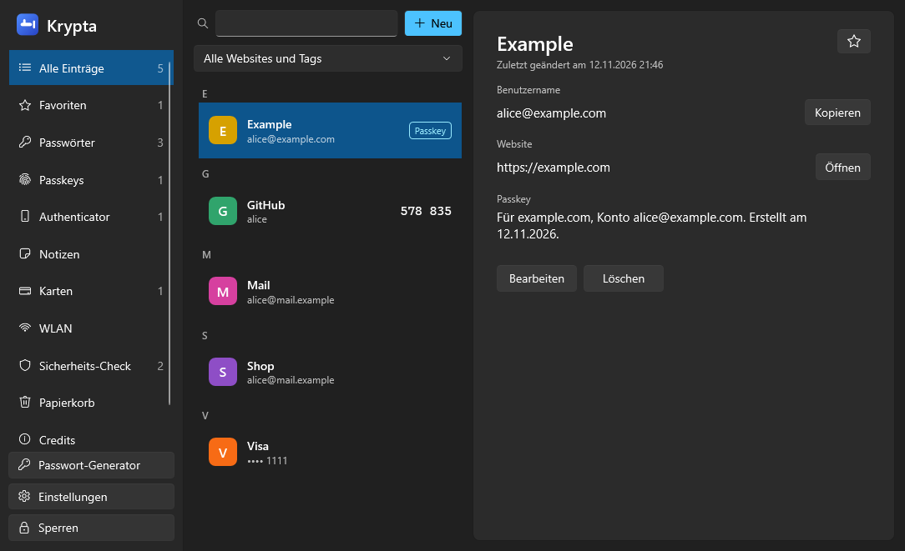 |
| Entsperren mit dem Master-Passwort | Passkeys liegen neben deinen Anmeldungen |
| 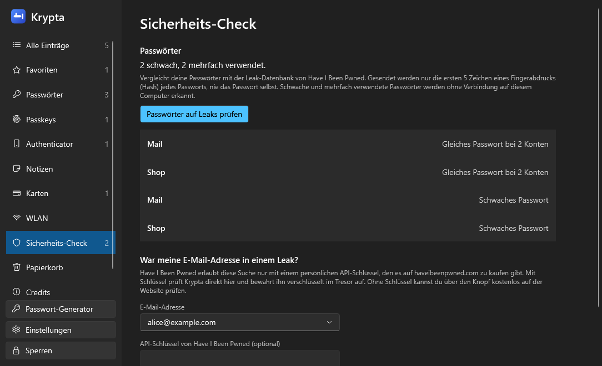 | 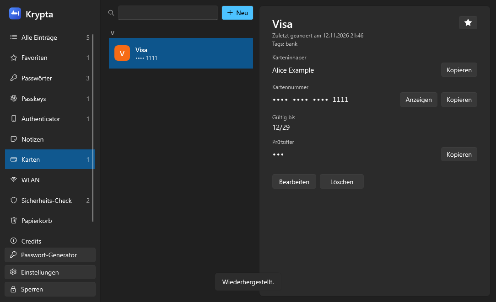 |
| Sicherheits-Check: schwache, mehrfach verwendete und geleakte Passwörter | Karten, Notizen und WLAN-Zugänge |
| 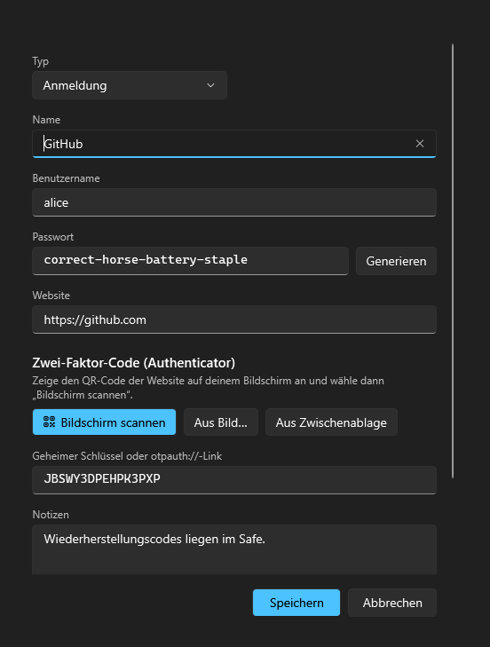 | 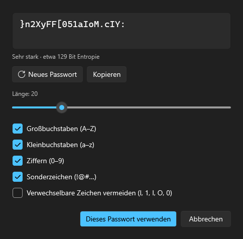 |
| Eintrag bearbeiten und einen Zwei-Faktor-QR-Code vom Bildschirm scannen | Passwort-Generator |
| 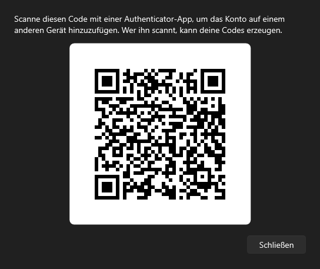 | 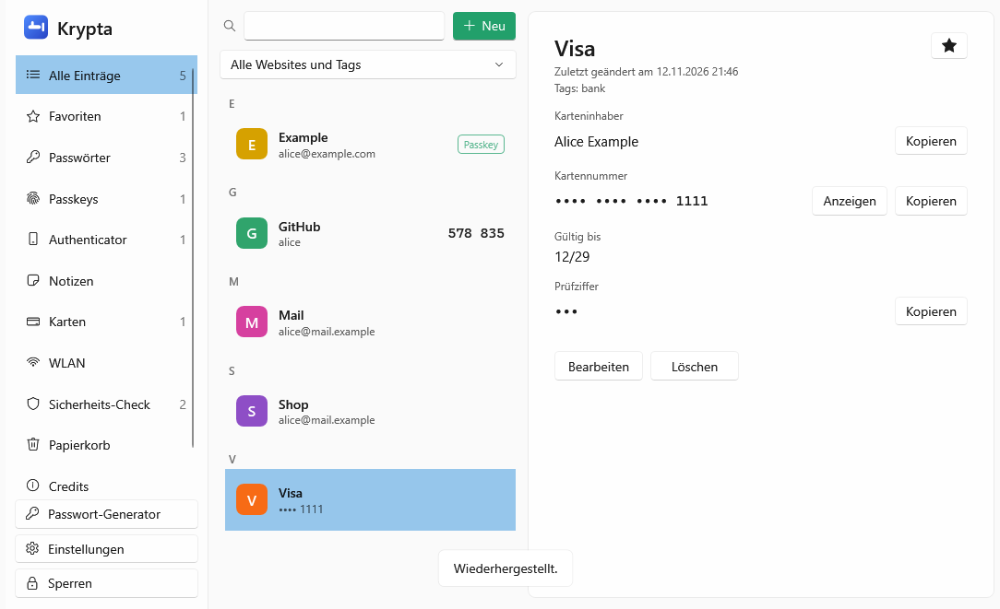 |
| Einen Code als QR anzeigen, um ihn auf einem anderen Gerät hinzuzufügen | Helle Darstellung mit anderer Akzentfarbe |
| 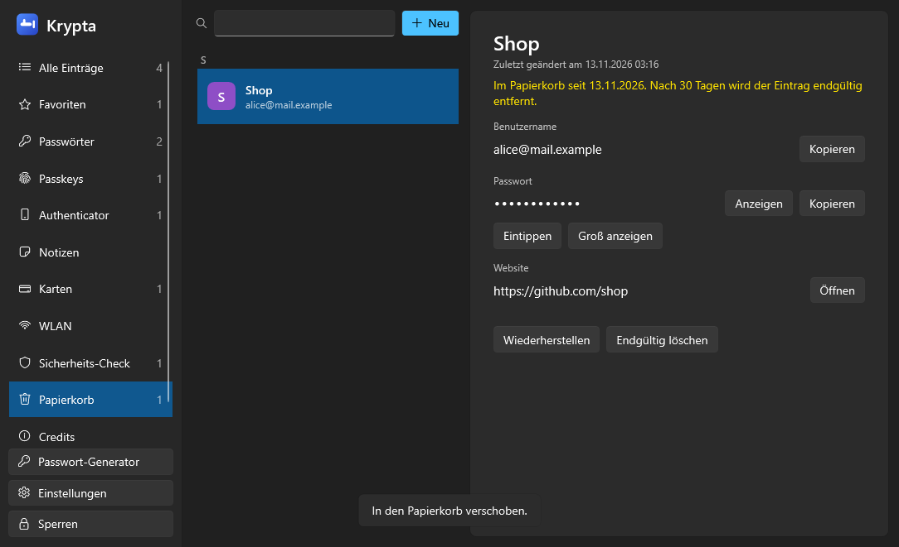 | 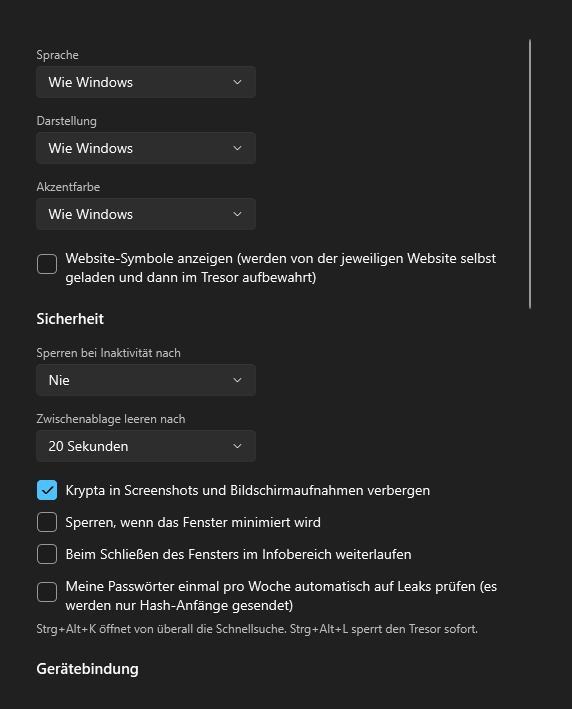 |
| Papierkorb: Gelöschte Einträge lassen sich 30 Tage wiederherstellen | Einstellungen: Sprache, Darstellung und Sicherheit |
| 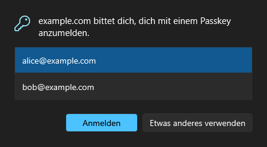 | 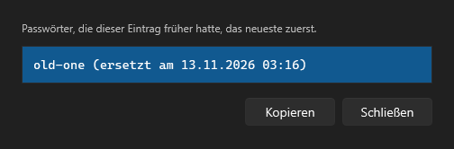 |
| Eine Website verlangt einen Passkey, und Krypta fragt dich zuerst | Verlauf früherer Passwörter |
| 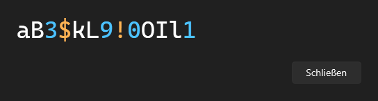 | 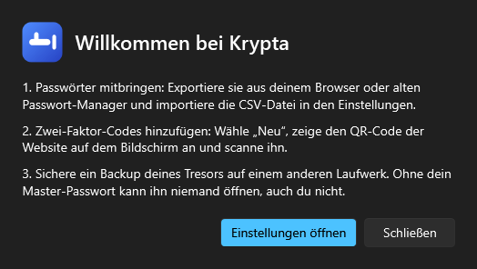 |
| Großansicht zum Ablesen eines Passworts | Erste Schritte nach dem Erstellen eines Tresors |
| 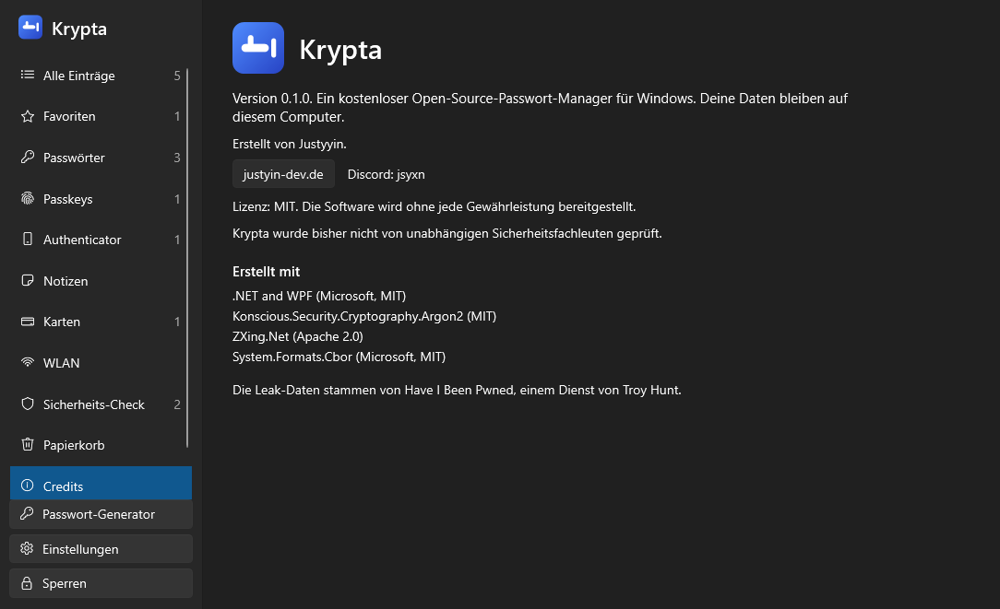 | |
| Credits | |

## So werden deine Daten geschützt

| Schutz | Bedeutung |
|---|---|
| Argon2id + AES-256-GCM | Der Tresor wird mit einem Schlüssel verschlüsselt, der aus deinem Master-Passwort abgeleitet wird (64 MiB, 3 Durchläufe). Jede Änderung an der Datei wird erkannt. |
| Schlüsseldatei (optional) | Ein zweiter Faktor: Der Tresor öffnet sich nur zusammen mit einer Datei, die du auf einem USB-Stick aufbewahrst. |
| Gerätebindung (optional, TPM) | Eine kopierte Tresor-Datei lässt sich auf einem anderen Computer nicht öffnen, selbst mit Master-Passwort, außer mit deinem Wiederherstellungsschlüssel. |
| Schlüssel im Speicher | Der Tresor-Schlüssel liegt verschlüsselt im Arbeitsspeicher, solange Krypta läuft. |
| Prozessschutz | Andere Programme, die unter deinem Benutzer laufen, können Krypta nicht öffnen, um den Speicher zu lesen, Code einzuschleusen oder einen Debugger anzuhängen. |
| Keine Screenshots | Krypta-Fenster erscheinen nicht in Screenshots und Bildschirmaufnahmen. |
| Zwischenablage | Kopierte Geheimnisse landen nicht im Windows-Zwischenablageverlauf oder in der Cloud-Synchronisierung und werden nach wenigen Sekunden gelöscht. |
| Auto-Sperre | Nach Inaktivität, wenn Windows gesperrt wird, wenn der PC in den Ruhezustand geht, und sofort mit `Strg+Alt+L`. |
| Anfragen aus dem Browser | Passkeys und Passwörter gehen nur an die Website, zu der sie gehören, und erst nach einem Klick in einem Krypta-Fenster. |

### Was Krypta nicht kann

- **Kein Passwort-Manager ist „Infostealer-sicher“.** Schadsoftware mit Administratorrechten oder Schadsoftware, die aktiv ist, während dein Tresor offen ist, kann weiterhin mitlesen, was du tippst oder siehst. Krypta erschwert den üblichen Angriff deutlich: Dateien kopieren und den Speicher anderer Programme auslesen.
- **Krypta ist absichtlich nicht „Reverse-Engineering-sicher“.** Der Code ist öffentlich. Die Sicherheit beruht auf der Verschlüsselung und deinem Master-Passwort, nicht auf Geheimhaltung.
- **Ein vergessenes Master-Passwort lässt sich nicht wiederherstellen.** Ebenso wenig ein Tresor, dessen Schlüsseldatei verloren ist, oder ein gerätegebundener Tresor ohne Wiederherstellungsschlüssel, wenn das Gerät weg ist.

Krypta verbindet sich nur für die Leak-Prüfung mit dem Internet (auf Wunsch, oder wöchentlich, wenn du das einschaltest) und, falls eingeschaltet, um Website-Symbole von den Websites selbst zu laden. Die technischen Details und der Meldeweg für Sicherheitslücken stehen in [SECURITY.md](SECURITY.md).

## Erste Schritte

Es gibt noch keinen Installer, daher wird Krypta aus dem Quellcode gebaut. Du brauchst Windows 10 (Version 2004 oder neuer) oder Windows 11 und das [.NET 10 SDK](https://dotnet.microsoft.com/download).

```
git clone https://github.com/Justyyin/Krypta.git
cd Krypta
dotnet build -c Release
artifacts\bin\Krypta.App\release\Krypta.exe
```

Beim ersten Start:

1. Wähle ein Master-Passwort mit mindestens zehn Zeichen. Ein langer Satz ist besser als ein kurzes, kompliziertes Wort.
2. Binde den Tresor auf Wunsch an dieses Gerät und verlange eine Schlüsseldatei. Schreibe den angezeigten Wiederherstellungsschlüssel auf.
3. Importiere deine bisherigen Passwörter unter **Einstellungen → Backup, Import und Export** und lösche danach die CSV-Datei.
4. Speichere ein Backup auf einem anderen Laufwerk.

## Krypta benutzen

**Zwei-Faktor-Codes.** Wähle **Neu**, zeige den QR-Code der Website auf deinem Bildschirm an und wähle **Bildschirm scannen**. Krypta liest den Code auch dann, wenn das eigene Fenster ihn verdeckt. Eine Bilddatei oder die Zwischenablage funktionieren ebenfalls, genauso das Eintippen des geheimen Schlüssels.

**Tastenkürzel**

| Kürzel | Aktion |
|---|---|
| `Strg+Alt+K` | Schnellsuche aus jedem Programm. Enter kopiert das Passwort, Strg+Enter öffnet den Eintrag. |
| `Strg+Alt+L` | Den Tresor sofort sperren. |

**Tippen statt kopieren.** Klicke in das Feld, das gefüllt werden soll, wechsle zu Krypta und wähle **Eintippen**. Krypta tippt Benutzername, Tab und Passwort in dieses Fenster, sodass nichts über die Zwischenablage läuft.

**Import und Export.** Krypta liest die CSV-Exporte von Chrome, Edge, Firefox, Bitwarden, KeePass und KeePassXC, einschließlich Zwei-Faktor-Schlüsseln, Ordnern und Favoriten, soweit die Datei sie enthält. Ein CSV-Export ist nicht verschlüsselt und enthält keine Passkeys und Karten; für eine sichere Kopie nimm **Backup speichern**.

**Leak-Prüfung.** Passwörter zu prüfen ist kostenlos und anonym: Nur die ersten fünf Zeichen eines Hashes verlassen deinen Computer. Die Suche nach E-Mail-Adresse braucht einen persönlichen API-Schlüssel, den Have I Been Pwned verkauft. Mit Schlüssel prüft Krypta in der App; ohne Schlüssel öffnet ein Knopf deren Website, wo die Suche kostenlos ist.

**Papierkorb.** Gelöschte Einträge lassen sich 30 Tage lang wiederherstellen. Danach, oder mit **Endgültig löschen**, sind sie weg.

## Browser-Erweiterung

Die Erweiterung verbindet Chrome, Edge, Brave und Firefox mit der laufenden App. Sie speichert und verwendet Passkeys und füllt Anmeldungen aus.

1. In Krypta: **Einstellungen → Passkeys im Browser → Browser verbinden**.
2. Chrome, Edge oder Brave: die Erweiterungsseite öffnen, den Entwicklermodus einschalten, **Entpackte Erweiterung laden** wählen und den Ordner `extension` auswählen.
3. Firefox: `extension/make-firefox.ps1` ausführen, `about:debugging` öffnen, **Dieser Firefox → Temporäres Add-on laden** wählen und `artifacts/extension-firefox/manifest.json` auswählen.

Passkeys funktionieren von selbst: Wenn eine Website einen verlangt, zeigt Krypta ein Bestätigungsfenster. Um eine Anmeldung auszufüllen, klicke auf das Krypta-Symbol in der Symbolleiste und wähle das Konto. Ist Krypta geschlossen oder wählst du „Etwas anderes verwenden“, erscheint wie gewohnt der Dialog des Browsers.

Die Erweiterung ist bis zur App getestet (Brückenprogramm, Prüfung der Anfragen, Signaturen), aber noch nicht in echten Browsern auf vielen Websites; die Firefox-Variante ist ungetestet. Bitte melde, was nicht funktioniert.

## Fragen und Antworten

**Wo liegen meine Daten?** In einer Datei, standardmäßig `%APPDATA%\Krypta\vault.krypta`. Du kannst sie überall aufbewahren, auch auf einem USB-Stick.

**Kann ich zwischen Geräten synchronisieren?** Krypta hat keine Synchronisierung. Du kannst die Tresor-Datei in einen Ordner legen, den ein anderes Werkzeug synchronisiert; sie ist verschlüsselt. Binde einen solchen Tresor nicht an ein Gerät.

**Was, wenn ich mein Master-Passwort vergesse?** Dann lässt sich der Tresor nicht öffnen. Es gibt keine Hintertür.

**Warum zeigt Windows beim Start eine Warnung?** Das Programm ist noch nicht signiert.

**Ist der Name schon vergeben?** Einige kleine, unabhängige Passwort-Werkzeuge heißen ebenfalls Krypta. Dieses Projekt hat mit ihnen nichts zu tun.

## Für Entwickler

| Ordner | Inhalt |
|---|---|
| `src/Krypta.Core` | Tresor-Format und Verschlüsselung, Generator, TOTP, Passkeys (WebAuthn), QR-Codes, Suche, Sicherheits-Check, Import und Export |
| `src/Krypta.App` | Die Windows-App (WPF), Schutzmaßnahmen, deutsche und englische Texte |
| `src/Krypta.NativeHost` | Kleine Brücke zwischen Browser-Erweiterung und App |
| `extension` | Browser-Erweiterung (Manifest V3) |
| `tests/Krypta.Tests` | Tests |
| `assets`, `docs` | Logo und Bildschirmfotos |

```
dotnet test
```

Die Tests enthalten die offiziellen Prüfwerte für Argon2id und TOTP, Signaturprüfungen für Passkeys, die Strecke vom Brückenprogramm in die App und einen Lauf, der jedes Fenster in beiden Sprachen öffnet. Dieser Lauf schreibt auch die Bilder dieser Datei nach `artifacts/ui`. `python assets/make_icons.py` erzeugt die Symbole aus dem Logo neu.

Beiträge sind willkommen. Halte bitte die beiden Sprachdateien im Gleichschritt; ein Test schlägt fehl, wenn ein Text in einer davon fehlt.

## Was noch offen ist

- Entsperren mit Windows Hello
- Eingabe des Master-Passworts auf dem sicheren Desktop
- Ein Hardware-Schlüssel (YubiKey) als zweiter Faktor
- Ein eigener Windows-11-Passkey-Anbieter, damit keine Browser-Erweiterung nötig ist
- QR-Codes mit der Webcam scannen
- Ein Installer und signierte Releases
- Eine unabhängige Sicherheitsprüfung

## Credits und Lizenz

Erstellt von Justyyin ([justyin-dev.de](http://justyin-dev.de/), Discord: jsyxn).

Veröffentlicht unter der [MIT-Lizenz](LICENSE). Gebaut mit .NET und WPF, Konscious.Security.Cryptography.Argon2, ZXing.Net und System.Formats.Cbor. Leak-Daten von Have I Been Pwned (Troy Hunt).
