<p align="center"></p>
<h1 align="center">Krypta</h1>
<p align="center">
  A free, open-source password manager for Windows that keeps everything on your computer.<br>
  Passwords, passkeys and two-factor codes in one encrypted vault. No account, no cloud.
</p>
<p align="center"><a href="README.de.md">Deutsche Version</a></p>

<p align="center">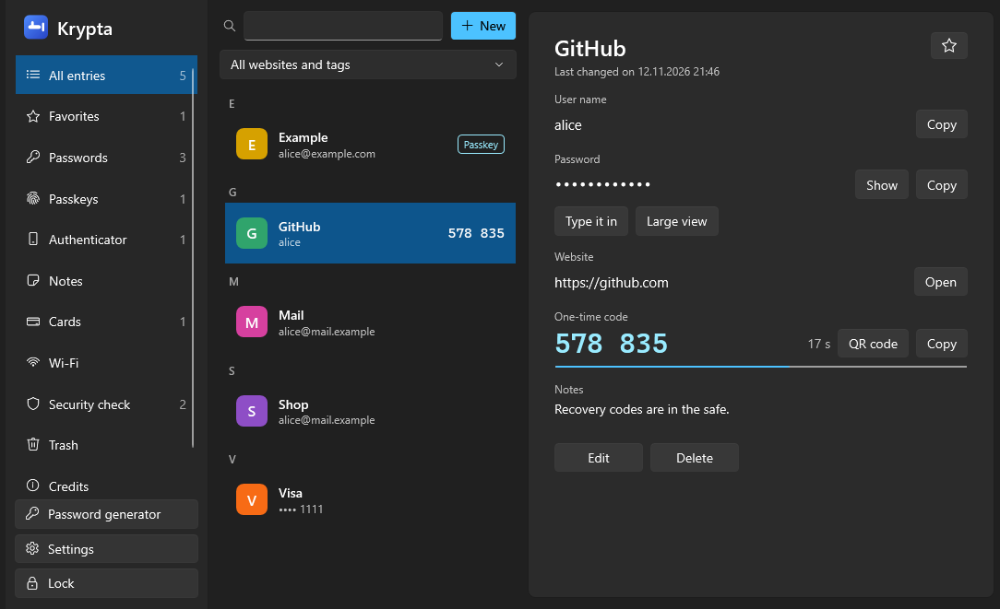</p>

> **Status: early version (0.1).** Krypta has not been reviewed by independent security experts yet.
> Keep a backup of anything important until it has.

## Contents

- [Features](#features)
- [Screenshots](#screenshots)
- [How your data is protected](#how-your-data-is-protected)
- [Getting started](#getting-started)
- [Using Krypta](#using-krypta)
- [Browser extension](#browser-extension)
- [Questions and answers](#questions-and-answers)
- [For developers](#for-developers)
- [What is still open](#what-is-still-open)
- [Credits and license](#credits-and-license)

## Features

**Everything in one vault**

- Logins, secure notes, payment cards and Wi-Fi networks.
- Passkeys: create them on websites and sign in with them.
- Two-factor codes (TOTP), like Microsoft or Google Authenticator.
- Several vaults, for example one private and one for work.

**Finding things quickly**

- A list in the style of Apple's Passwords app: coloured tiles, alphabetical sections and counters.
- Search over several words ("git alice"), filters by website and by tag, favourites.
- Quick search from anywhere with `Ctrl+Alt+K`.

**Staying safe**

- Password generator with an entropy estimate.
- Security check for weak, reused and leaked passwords.
- Trash that keeps deleted entries for 30 days, and a history of the last ten passwords per entry.
- Encrypted backups; import from Chrome, Edge, Firefox, Bitwarden, KeePass and KeePassXC.

**Comfort**

- German and English, switchable at any time.
- Light or dark appearance and six accent colours.
- Fill in logins in the browser, or let Krypta type a password into any window.

## Screenshots

| | |
|---|---|
| 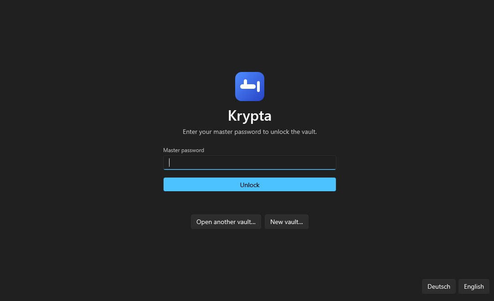 | 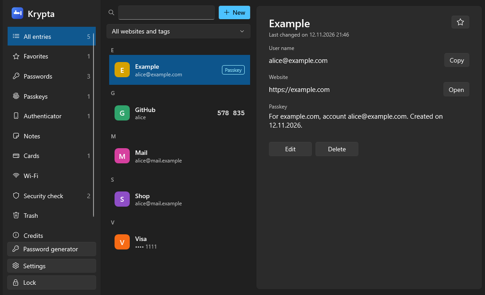 |
| Unlock with your master password | Passkeys are stored next to your logins |
| 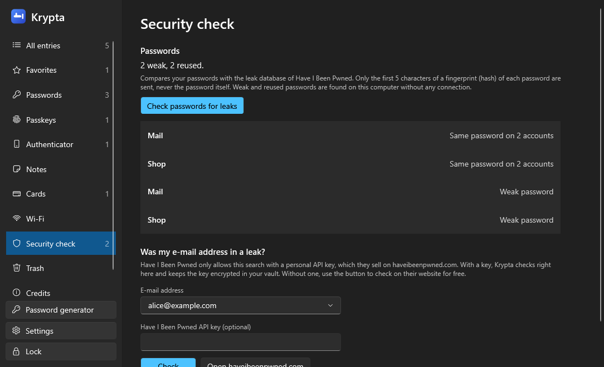 | 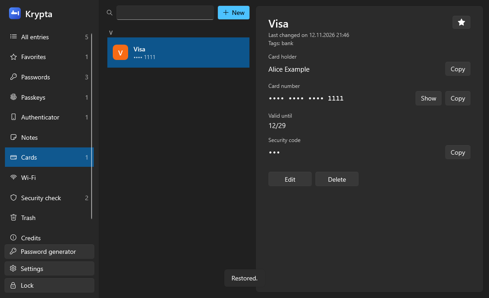 |
| Security check: weak, reused and leaked passwords | Cards, notes and Wi-Fi networks |
| 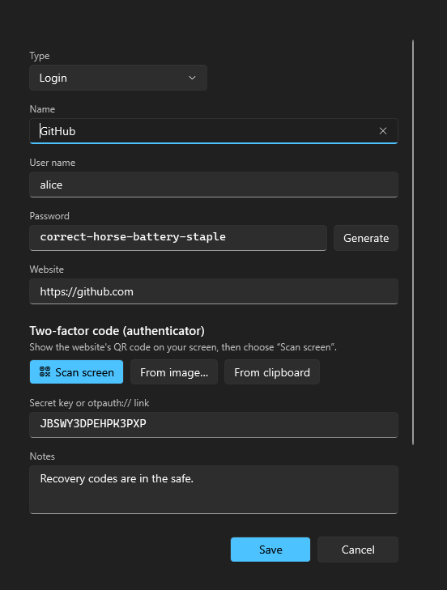 | 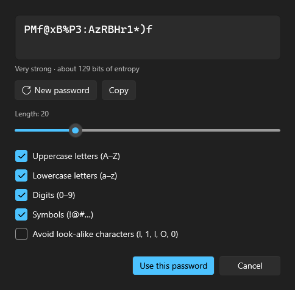 |
| Edit an entry and scan a two-factor QR code from the screen | Password generator |
| 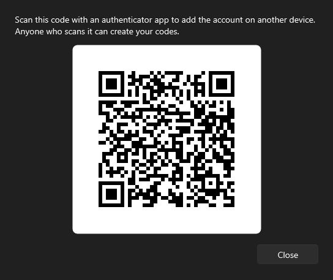 | 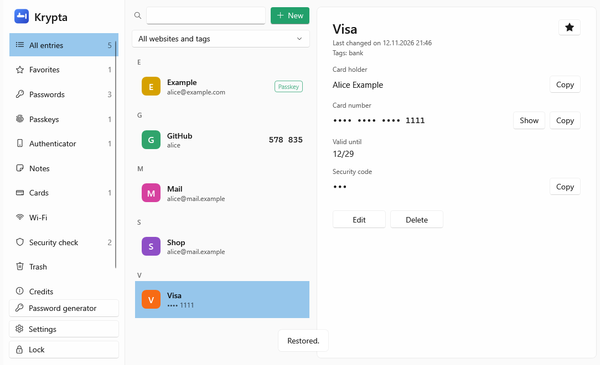 |
| Show a code as QR to add it on another device | Light appearance with another accent colour |
| 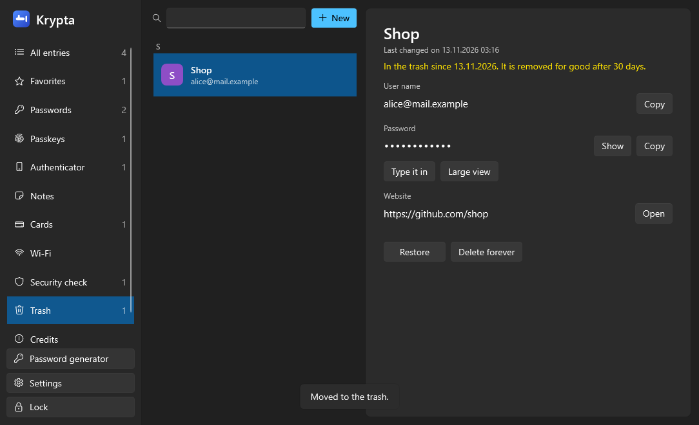 | 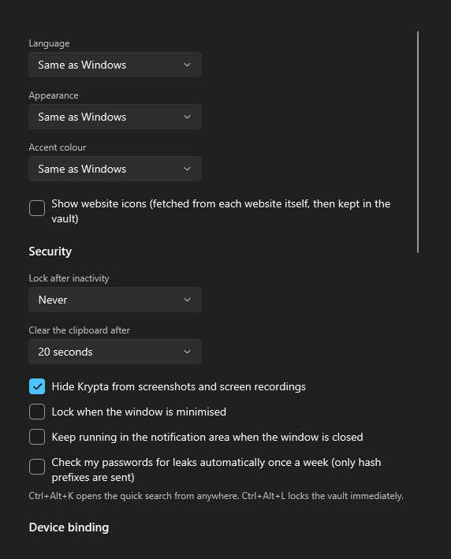 |
| Trash: deleted entries can be restored for 30 days | Settings: language, appearance and security |
| 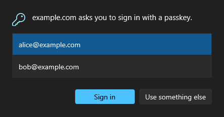 | 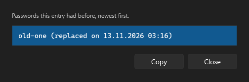 |
| A website asks for a passkey and Krypta asks you first | History of earlier passwords |
| 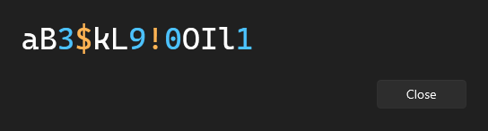 | 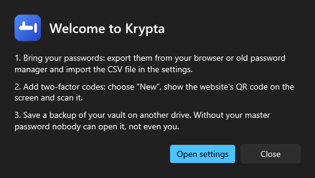 |
| Large view for reading a password off the screen | First steps after creating a vault |
| 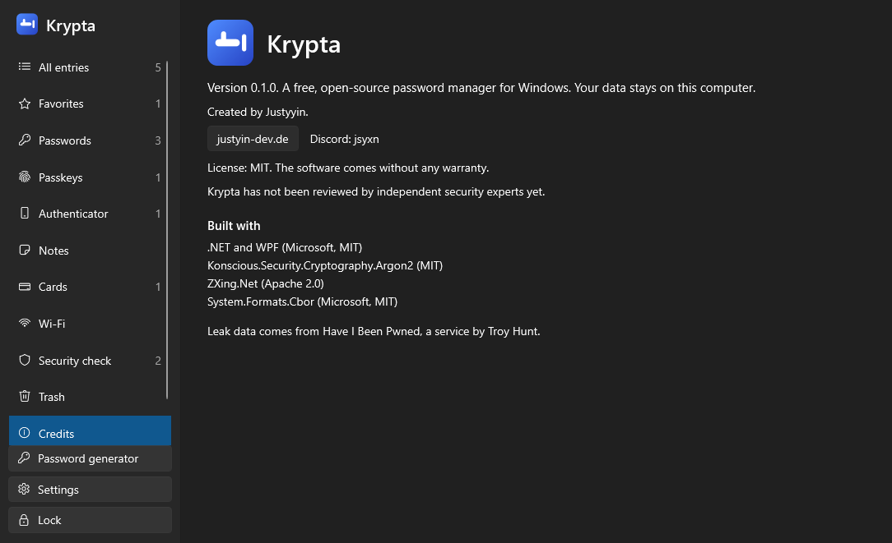 | |
| Credits | |

## How your data is protected

| Protection | What it means |
|---|---|
| Argon2id + AES-256-GCM | The vault is encrypted with a key derived from your master password (64 MiB, 3 passes). Any change to the file is detected. |
| Key file (optional) | A second factor: the vault only opens together with a file you keep on a USB stick. |
| Device binding (optional, TPM) | A copied vault file cannot be opened on another computer, even with the master password, without your recovery key. |
| Key in memory | The vault key is kept encrypted in memory while Krypta runs. |
| Process protection | Other programs running as you cannot open Krypta to read its memory, inject code or attach a debugger. |
| No screenshots | Krypta's windows are left out of screenshots and screen recordings. |
| Clipboard | Copied secrets stay out of the Windows clipboard history and cloud sync, and are cleared after a few seconds. |
| Auto-lock | After inactivity, when Windows locks, when the PC goes to sleep, and at once with `Ctrl+Alt+L`. |
| Browser requests | Passkeys and passwords are only given to the website they belong to, and only after a click in a Krypta window. |

### What it cannot do

- **No password manager is "info-stealer proof".** Malware with administrator rights, or malware that is active while your vault is unlocked, can still capture what you type or see. Krypta makes the common attack, copying files and reading other programs' memory, much harder.
- **It is not "reverse-engineering proof", on purpose.** The code is public. Its security rests on the encryption and your master password, not on secrecy.
- **A forgotten master password cannot be recovered.** Neither can a vault whose key file is lost, or a device-bound vault without the recovery key once the device is gone.

Krypta only connects to the internet for the leak check (on request, or weekly if you turn that on) and, if you turn them on, to load website icons from the websites themselves. The technical details and the way to report a vulnerability are in [SECURITY.md](SECURITY.md).

## Getting started

There is no installer yet, so Krypta is built from the source code. You need Windows 10 (version 2004 or newer) or Windows 11 and the [.NET 10 SDK](https://dotnet.microsoft.com/download).

```
git clone https://github.com/Justyyin/Krypta.git
cd Krypta
dotnet build -c Release
artifacts\bin\Krypta.App\release\Krypta.exe
```

On the first start:

1. Choose a master password of at least ten characters. A long sentence is better than a short, complicated word.
2. Optionally bind the vault to this device and require a key file. Write down the recovery key that is shown.
3. Import your existing passwords under **Settings → Backup, import and export**, then delete the CSV file.
4. Save a backup on another drive.

## Using Krypta

**Two-factor codes.** Choose **New**, show the website's QR code on your screen and choose **Scan screen**. Krypta reads the code even when its own window covers it. An image file or the clipboard work as well, and so does typing the secret key.

**Keyboard shortcuts**

| Shortcut | Action |
|---|---|
| `Ctrl+Alt+K` | Quick search from any program. Enter copies the password, Ctrl+Enter opens the entry. |
| `Ctrl+Alt+L` | Lock the vault immediately. |

**Typing instead of copying.** Click into the field you want to fill, switch to Krypta and choose **Type it in**. Krypta types the user name, Tab and the password into that window, so nothing goes through the clipboard.

**Import and export.** Krypta reads the CSV exports of Chrome, Edge, Firefox, Bitwarden, KeePass and KeePassXC, including two-factor secrets, folders and favourites where the file has them. A CSV export is not encrypted and leaves out passkeys and cards; for a safe copy use **Save backup**.

**Leak check.** Checking passwords is free and anonymous: only the first five characters of a hash leave your computer. Searching by e-mail address needs a personal API key that Have I Been Pwned sells. With a key Krypta checks inside the app; without one a button opens their website, where the search is free.

**Trash.** Deleted entries can be restored for 30 days. After that, or with **Delete forever**, they are gone.

## Browser extension

The extension connects Chrome, Edge, Brave and Firefox to the running app. It saves and uses passkeys, and it fills in logins.

1. In Krypta: **Settings → Passkeys in the browser → Connect browsers**.
2. Chrome, Edge or Brave: open the extensions page, turn on developer mode, choose **Load unpacked** and select the `extension` folder.
3. Firefox: run `extension/make-firefox.ps1`, open `about:debugging`, choose **This Firefox → Load Temporary Add-on** and select `artifacts/extension-firefox/manifest.json`.

Passkeys work on their own: when a website asks for one, Krypta shows a confirmation window. To fill in a login, click the Krypta icon in the toolbar and choose the account. If Krypta is closed, or you choose "Use something else", the browser's own dialog appears as usual.

The extension has been tested up to the app (bridge program, request checks, signatures) but not yet in real browsers across many websites; the Firefox variant is untested. Please report what does not work.

## Questions and answers

**Where is my data?** In one file, by default `%APPDATA%\Krypta\vault.krypta`. You can keep it anywhere, including a USB stick.

**Can I sync between devices?** Krypta has no sync. You can put the vault file in a folder that another tool synchronises; it is encrypted. Do not bind such a vault to a device.

**What if I forget my master password?** Then the vault cannot be opened. There is no back door.

**Why does Windows show a warning when I start it?** The program is not signed yet.

**Is the name taken?** A few small, unrelated password tools are also called Krypta. This project has nothing to do with them.

## For developers

| Folder | Content |
|---|---|
| `src/Krypta.Core` | Vault format and encryption, generator, TOTP, passkeys (WebAuthn), QR codes, search, security check, import and export |
| `src/Krypta.App` | The Windows app (WPF), protections, German and English texts |
| `src/Krypta.NativeHost` | Small bridge between the browser extension and the app |
| `extension` | Browser extension (Manifest V3) |
| `tests/Krypta.Tests` | Tests |
| `assets`, `docs` | Logo and screenshots |

```
dotnet test
```

The tests include the official test vectors for Argon2id and TOTP, signature checks for passkeys, the route from the bridge program into the app, and a run that opens every window in both languages. That run also writes the pictures used in this file to `artifacts/ui`. `python assets/make_icons.py` regenerates the icons from the logo.

Contributions are welcome. Please keep the two language files in step; a test fails when a text is missing in one of them.

## What is still open

- Unlock with Windows Hello
- Entering the master password on the secure desktop
- A hardware key (YubiKey) as second factor
- A native Windows 11 passkey provider, so that no browser extension is needed
- Scanning QR codes with a webcam
- An installer and signed releases
- An independent security review

## Credits and license

Created by Justyyin ([justyin-dev.de](http://justyin-dev.de/), Discord: jsyxn).

Released under the [MIT license](LICENSE). Built with .NET and WPF, Konscious.Security.Cryptography.Argon2, ZXing.Net and System.Formats.Cbor. Leak data by Have I Been Pwned (Troy Hunt).
